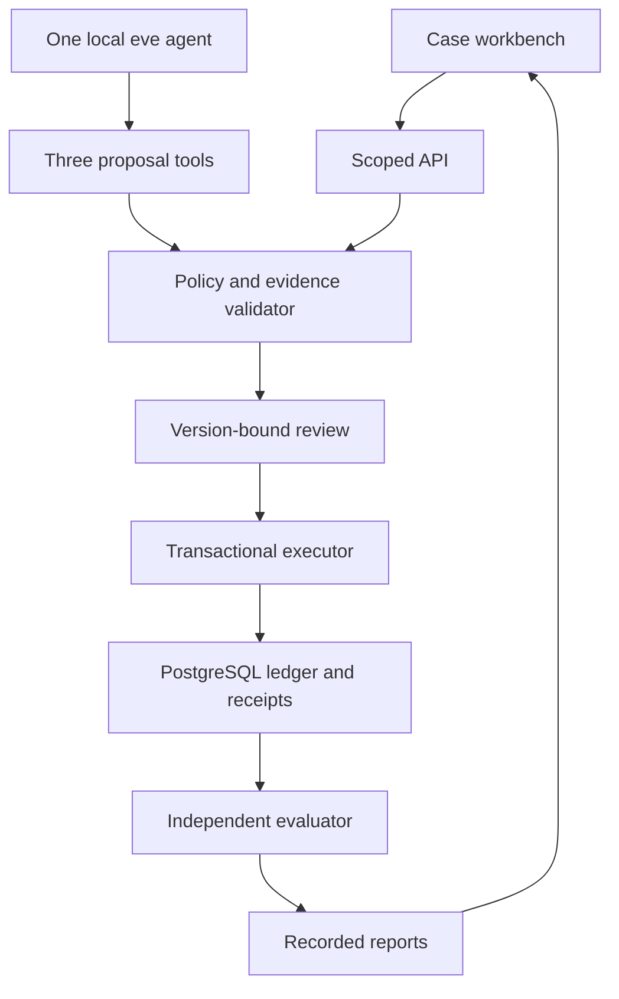

# Handoff

A synthetic support workbench that makes evidence, review and recovery visible. The browser runs a deterministic workflow against PostgreSQL. A separate eve agent uses a local Qwen model to propose resolutions through three restricted tools.

Synthetic support cases. Simulated actions only. Scripted, local-model and recorded runs are labeled separately. No real messages, refunds or customer data. This project does not demonstrate production customer-service readiness.

The source is published at [mekala27-45/handoff](https://github.com/mekala27-45/handoff). The hosted API is [handoff-blond-one.vercel.app](https://handoff-blond-one.vercel.app/health), and the workbench is [GitHub Pages](https://mekala27-45.github.io/handoff/). Read [RESULTS.md](RESULTS.md) for measured evidence and verification limits. Publication of recorded report files is pending artifact-specific authorization, so the public Evaluation view currently displays Not evaluated. The complete private review package preserves the original runs.

## Run locally

Use Node 24.19.0 and a disposable PostgreSQL 18 database. Copy `.env.example` to `.env` and configure a **direct** connection. Transaction-pooled endpoints are rejected. Keep credentials outside version control.

```sh
npm ci --no-audit --no-fund
npm run compile
node --env-file=.env build/scripts/migrate.js
npm start
```

In a second terminal:

```sh
npm run dev --workspace apps/site
```

Open http://127.0.0.1:5173. Start a synthetic damaged-delivery case, gather evidence, generate a scripted proposal, inspect its policy and facts, approve the exact version and execute. Repeat execution to recover the same receipt. The optional response-discard control is a client-side transport demonstration, clearly distinct from the process-crash evaluator.

## Verify and evaluate

```sh
npm run verify
npm run eval:scripted
npm run eval:faults
```

The full fault matrix is intentionally larger than a unit suite. It runs eight overlays for each of 80 held-out cases, writes incremental evidence and excludes explicitly non-applicable execution boundaries. Run it against an isolated database. It creates and terminates only its own API workers.

For actual model inference, follow [the runbook](docs/RUNBOOK.md). The public browser does not run a hosted model. The first held-out model version used Vulkan unexpectedly; the preserved CPU revision checks zero VRAM before every attempt. Read the resulting report rather than assuming model correctness from a successful tool call.

## Architecture



The agent database role cannot create approvals or effects. Runtime artifacts exclude evaluator truth. Money uses integer USD cents. Approval expiry is checked with database wall-clock time after business locks are acquired. Recovery checks committed effects before reconsidering old approval expiry.

## Repository map

| Path | Purpose |
| --- | --- |
| `apps/api` | Native HTTP API and strict request validation |
| `apps/site` | Four-view workbench and recorded evaluation display |
| `agent` | One eve agent, local channel and three tools |
| `packages/domain` | Policy, scope, transitions and execution |
| `packages/db` | Isolated schema and database role |
| `packages/fixtures` | Public synthetic data and fictional policy |
| `eval/plans` | Registered splits, selected IDs and frozen configurations |
| `eval/truth` | Evaluator-only independent oracle |
| `eval/harness` | Scripted, model and process-fault evaluators |
| `reports` | Measured runs and verification evidence |
| `skills` | Three repository instructions for coding agents |

See [the ADRs](docs/adr/001-one-agent.md), [release procedure](docs/RELEASE.md), [third-party notices](THIRD_PARTY.md) and [source probes](docs/sources/host-probes.json). The implementation is MIT licensed. Original synthetic fixtures are CC0. Model and font licenses are recorded separately.
