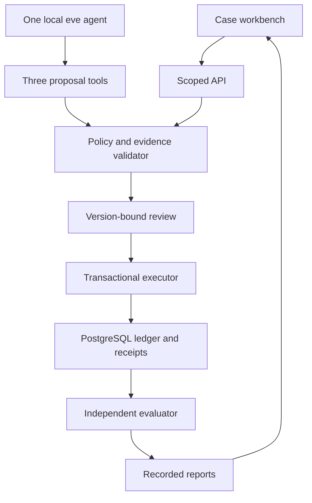

# Handoff

A synthetic support workbench that makes evidence, review and recovery visible. The browser runs a deterministic workflow against PostgreSQL. A separate eve agent uses a local Qwen model to propose resolutions through three restricted tools.

Synthetic support cases. Simulated actions only. Scripted, local-model and recorded runs are labeled separately. No real messages, refunds or customer data. This project does not demonstrate production customer-service readiness.

The source is published at [mekala27-45/handoff](https://github.com/mekala27-45/handoff). The hosted API is [handoff-blond-one.vercel.app](https://handoff-blond-one.vercel.app/health), and the workbench is [GitHub Pages](https://mekala27-45.github.io/handoff/). Recorded reports, failed attempts and model traces are published with the owner's explicit approval. The [latest release](https://github.com/mekala27-45/handoff/releases/latest) contains the authoritative generated RESULTS.md and release attestations for its exact tested commit. Until that release exists, the candidate remains under verification. The source [RESULTS.md](RESULTS.md) preserves the original measurement provenance and historical checklist.

## Run locally

Use Node 24.19.0 and a disposable PostgreSQL 18 database. Copy `.env.example` to `.env` and configure a **direct** connection. Transaction-pooled endpoints are rejected. Keep credentials outside version control.

```sh
npm ci --no-audit --no-fund
npm run compile
node --env-file=.env build/scripts/migrate.js
npm start
```

In a second terminal:

```sh
npm run dev --workspace apps/site
```

Open http://127.0.0.1:5173. Start a synthetic damaged-delivery case, gather evidence, generate a scripted proposal, inspect its policy and facts, approve the exact version and execute. Repeat execution to recover the same receipt. The optional response-discard control is a client-side transport demonstration, clearly distinct from the process-crash evaluator.

## Verify and evaluate

```sh
npm run verify
npm run eval:scripted
npm run eval:faults
```

The full fault matrix is intentionally larger than a unit suite. It runs eight overlays for each of 80 held-out cases, writes incremental evidence and excludes explicitly non-applicable execution boundaries. Run it against an isolated database. It creates and terminates only its own API workers.

For current agent-quality work, follow [the v4 runbook](docs/RUNBOOK.md#current-v4-protocol), [experiment notes](docs/MODEL-IMPROVEMENT-V4.md), [registered plan](eval/plans/model-experiment-v4.json) and [verified model lock](docs/sources/model-lock-v4.json). V4 runs the isolated `agent-v4` project with `qwen3:4b-q4_K_M` on a Linux CPU and disposable local PostgreSQL. It uses the same three bounded proposal tools. The original v3 implementation and frozen source hashes remain preserved.

V4 is still in development. Before freeze it must complete all sixteen registered development cases, produce at least fourteen independently correct proposals, and show zero accepted incorrect proposals. The independent SQL reads and calibrated authority observations must be complete, with zero model-case approvals, review records or effects. An unknown observation never becomes zero. A diagnostic pilot cannot qualify this gate. No qualifying v4 score, frozen configuration or held-out result is claimed here.

The historical v2 CPU result remains 0/16. V3 produced 8/16 on development and 2/16 on its fresh held-out subset, with two incorrect proposals rejected and twelve missing outputs. These records and their failed attempts remain separate. V4 reserves another sixteen held-out cases, excluding both earlier model subsets. Different held-out subsets are not a paired before/after comparison. The earlier version-one Vulkan run is also preserved separately and is not CPU evidence.

The public browser displays recorded model results alongside a live scripted workflow. It does not run a hosted model. Code validates proposals; the model has no approval or execution tool. Read actual stored-proposal grades and full denominators rather than inferring model quality from a successful tool call or runner exit.

## Architecture



The agent database role cannot create approvals or effects. Runtime artifacts exclude evaluator truth. Money uses integer USD cents. Approval expiry is checked with database wall-clock time after business locks are acquired. Recovery checks committed effects before reconsidering old approval expiry.

## Repository map

| Path | Purpose |
| --- | --- |
| `apps/api` | Native HTTP API and strict request validation |
| `apps/site` | Four-view workbench and recorded evaluation display |
| `agent` | Preserved v3 agent, local channel and three tools |
| `agent-v4` | Isolated current agent project using the locked 4B CPU model |
| `packages/domain` | Policy, scope, transitions and execution |
| `packages/db` | Isolated schema and database role |
| `packages/fixtures` | Public synthetic data and fictional policy |
| `eval/plans` | Registered splits, selected IDs and frozen configurations |
| `eval/truth` | Evaluator-only independent oracle |
| `eval/harness` | Scripted, model and process-fault evaluators |
| `reports` | Measured runs and verification evidence |
| `skills` | Three repository instructions for coding agents |

See [the ADRs](docs/adr/001-one-agent.md), [release procedure](docs/RELEASE.md), [third-party notices](THIRD_PARTY.md) and [source probes](docs/sources/host-probes.json). The implementation is MIT licensed. Original synthetic fixtures are CC0. Model and font licenses are recorded separately.
